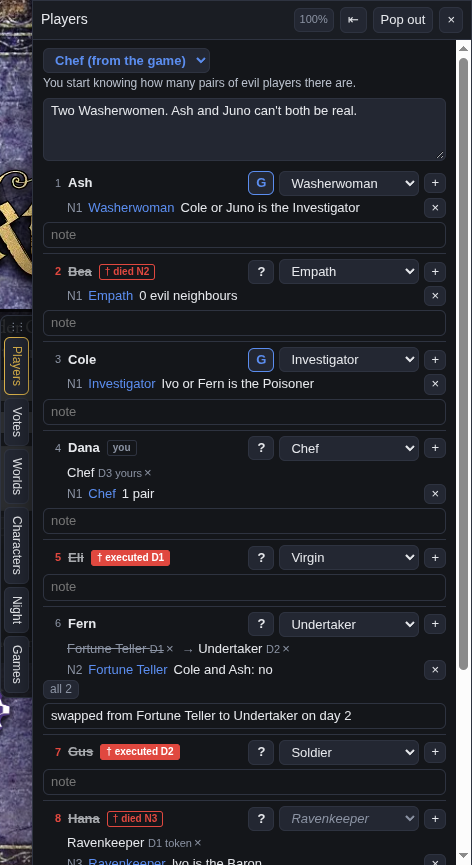
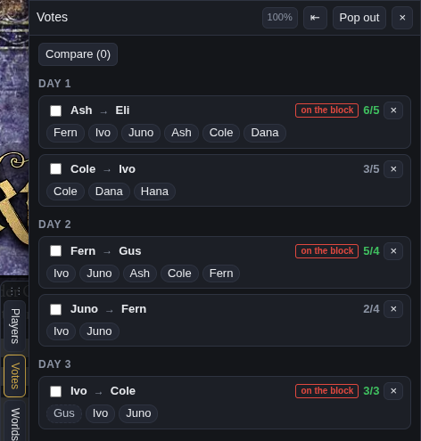
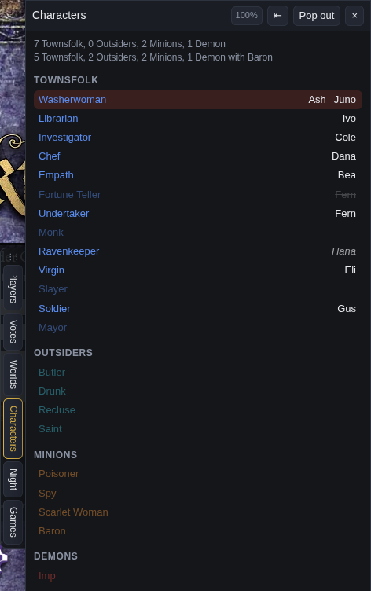
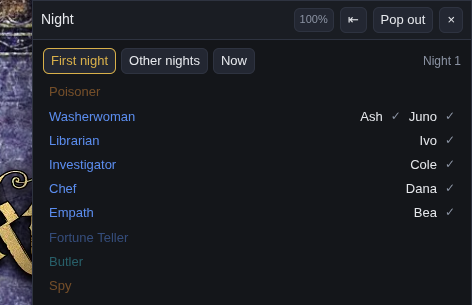
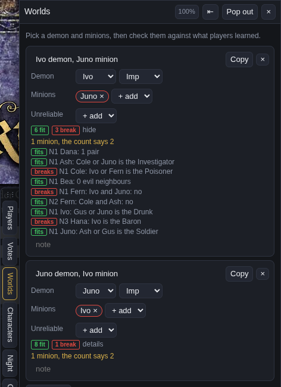

# BOTC tracker

An add-on for Firefox and Chrome that works on [botc.app](https://botc.app). It puts the notes into panels on the town square and keeps track of votes.

## Panels

 

The screenshots are from a made-up game.

Votes is the reason this exists. The app only keeps vote history if you're the storyteller or have grimoire access, so the add-on saves every nomination once the clock hand finishes going round. Votes are grouped by day with voters in hand order, ghost votes dashed, and whoever ended up on the block marked. Tick a few and hit Compare to get a player by vote grid.

Players starts with your own character and its ability. It follows the game until you pick one, then stays put whatever the game or your public claim says. Under that go notes for the whole game, then a row per seat: claim, good/evil read, what they say they learned, and a note. The + on a row adds what they learned, already set to their claim. Only the latest line shows until you open the rest. Dead players get a red tag with how and when, so executed D1 or died N2.

Your grimoire feeds it too. Tokens you drop on seats count as claims (shown faded), and flipping a seat to good or evil, or putting a Minion or Demon on it, sets the read. A read you set by hand stays until that seat changes on the board. Claim changes keep their order and the phase they happened in, so someone going from Investigator to Undertaker shows both, and Characters and Worlds go by the latest.

 

Characters lists the script's characters (hover one for its ability, worded as on the character sheet) and who claims each, with double claims, unclaimed characters and players who haven't claimed anything. The setup counts at the top know about the Baron and the other characters that change them.

Night is a compact night order: the script's characters in wake order for tonight (or the coming night during the day), who claims each, and a tick once you've logged what that player learned that night. It switches between first and other nights by itself, or you can pick.

Worlds lets you pick a demon and minions and shows which info fits that world and which breaks it. It checks these characters:

- Trouble Brewing: Washerwoman, Librarian, Investigator, Chef, Empath, Fortune Teller, Undertaker, Ravenkeeper
- Sects & Violets: Clockmaker, Dreamer, Oracle, Seamstress, Sage, Snake Charmer, Flowergirl and Town Crier (those two read the saved votes)
- Bad Moon Rising: Grandmother, and a Gambler who guessed and lived
- the rest: Noble, Steward, Knight, Shugenja, Bounty Hunter, Village Idiot

Anything else goes in as free text and isn't checked. Each world can say which demon it is. With a Vortox, Townsfolk info has to be false to fit. With a No Dashii, its nearest Townsfolk on each side are treated as poisoned. Wrong info from a player the world makes evil counts as a lie, not a break, and you can mark anyone else drunk or poisoned by hand.

Games keeps your last few games. A new one starts by itself when the storyteller starts a game.

Click a name anywhere to highlight that player in every panel.

## Windows

The tabs sit on the edge of the screen. Click one and its panel slides out with the tabs attached to its side; click it again to put it away. Drag the panel's inner edge to make it wider. The arrow in the title bar moves the whole thing to the other side of the screen, and the grip at the top of the tabs slides them up or down.

botc.app has its own sheets on the edges (Characters, night order, Voice, Text). The tabs only move aside for one at the same height. An open panel keeps clear of them as well, apart from the Characters sheet, which it covers since our Characters tab has the same list. It also stops short of the controls at the top right and the phase box at the bottom.

Pop out turns a panel into a window you can drag and resize, and you can have as many of those open as you like. The percentage button fades the background (100, 80, 60, 40%) so the town square shows through.

Seats, deaths, your character and the script come from the same game state the town square is drawn from, so the add-on never sees anything you can't see on screen. Everything is saved in the browser's local storage for botc.app.

## Install

You need Firefox 140 or newer.

1. Grab `botc-tracker.xpi` from the [latest release](https://github.com/akulik1990/botc-tracker/releases/latest), or build it with `git archive --format=zip -o botc-tracker.xpi HEAD manifest.json vendor src`
2. In `about:config`, set `xpinstall.signatures.required` to `false`
3. In `about:addons`, open the gear menu, choose Install Add-on From File and pick the `.xpi`

### Chrome, Opera and other Chromium browsers

The same add-on runs in Chrome and Opera (tested in Chromium 156), but they only take extensions from outside their stores in developer mode, and those don't update themselves.

1. Download `botc-tracker.zip` from the [latest release](https://github.com/akulik1990/botc-tracker/releases/latest) and unzip it into a folder you keep
2. Open `chrome://extensions` (Opera: `opera://extensions`) and switch on Developer mode
3. Click Load unpacked and pick that folder

To update, unzip the new release over the same folder, click the reload arrow on the extension, then reload the botc.app tab.

Vue 3.5.13 is bundled in `vendor/` (MIT).
